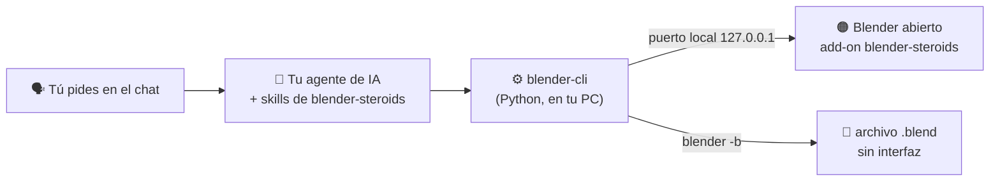

# blender-steroids

<p align="center">
  
  <a href="https://github.com/kennedy122112/blender-steroids/actions/workflows/tests.yml"></a>
  
  
  <a href="LICENSE"></a>
</p>

<p align="center">
  
  
  
</p>

<p align="center">
  <b>Describe lo que quieres en 3D. Tu agente de IA lo modela en Blender: objetos, materiales, luces, cámara y animación reales y editables, y te enseña el render.</b><br>
  Gratis y de código abierto. Local, sin MCP y sin API key.
</p>

<p align="center"><sub>Proyecto independiente, no afiliado a la Blender Foundation. Blender es una marca de la Blender Foundation.</sub></p>

---

## ✨ Qué es

**blender-steroids** es un conjunto de *skills*: instrucciones y herramientas que le enseñan a tu asistente de IA a trabajar en **Blender**. Le pides lo que necesitas con tus palabras y lo hace en tu Blender abierto:

- 🪑 **Modela** muebles, productos, maquetas, escenarios y logos 3D a partir de lo que describes, con medidas reales.
- 🎨 **Viste la escena**: materiales PBR (madera, metal, vidrio, neón, texturas), luces de estudio o exteriores, HDRI y cámara encuadrada sola.
- 🧸 **Personajes y formas orgánicas**: cajas redondeadas, cuerpos de bolas fundidas, tubos que siguen curvas, piezas torneadas, alas y aletas de membrana, y calcomanías y líneas pegadas a la superficie (ojos, bocas, logos).
- ✂️ **Siluetas a 3D**: convierte la silueta de una imagen (o una lista de puntos) en una pieza editable con sus huecos, usando Fourier para las curvas y polígonos para las esquinas, con el error medido: logos, emblemas, engranajes, llamas, letreros. Y de la foto de lado de un jarrón, una botella o un farol saca su perfil y lo gira, en franjas con el color de cada parte; también separa una parte por su color (una estrella pintada sobre el papel). Con una vista de frente y una de costado arma el volumen de lo que no es plano ni redondo (una regadera, un ratón, un zapato) y convierte las asas, picos, patas y ramas en tubos que siguen su forma, se ramifican y se meten en el cuerpo; las partes de color (alas, ojos, panza) quedan en su lugar, curvadas sobre el cuerpo y listas para animar. Puede entregarlas como curvas editables (Bézier) y cada pieza guarda con qué se hizo.
- 🕹️ **Estilo retro y animación**: pixel art en las texturas, render con look de consola de 32 bits y ciclos de caminata para personajes hechos de piezas.
- 📦 **Parte de modelos y recursos ya hechos**: importa tus modelos (glb, fbx, obj, stl, usd) y busca y descarga HDRI, texturas y modelos libres (CC0) de Poly Haven.
- 🖼️ **Trabaja con referencias**: lee proporciones y paleta de tu imagen, compara cada vuelta con ella alineada y con medidas, y revisa solo el armado (piezas flotando o atravesadas).
- 🎞️ **Anima** posición, rotación, escala o cualquier propiedad, con sus fotogramas clave, o **con ecuaciones**: aleteos y oscilaciones por frecuencia, resortes que rebotan y se asientan, péndulos reales y movimiento secundario (una antena que se bambolea al caminar), con aviso si los fps no alcanzan.
- 👀 **Se revisa a sí mismo**: renderiza vistas de control (iso, frente, arriba...) y corrige lo que se ve mal antes de entregarte.
- 📸 **Renderiza** imágenes y animaciones con EEVEE o Cycles, sin congelar tu Blender.
- 📦 **Exporta** a GLB/glTF, FBX, OBJ, STL (impresión 3D), PLY y USD.
- 🔍 **Lee y audita** un `.blend`: qué hay por colección, objetos sin material, escalas sin aplicar, materiales sin uso.

Todo queda como escena nativa de Blender: objetos con nombre, colecciones, modificadores editables y Ctrl+Z.

## 🧭 Cómo funciona



Tu **agente de IA** (Claude Code, Codex, OpenCode o Antigravity) entiende lo que pides y escribe la escena como un pequeño archivo JSON. **blender-cli** se lo pasa al **add-on** que corre dentro de tu Blender, que la construye con la API de Python de Blender. También puede trabajar **sin interfaz** sobre un `.blend`. Nada pasa por la nube y repetir un pedido no duplica nada: actualiza lo que ya existe.

## 🧰 Qué necesitas

| Necesitas | Para qué | ¿Lo tengo? |
|---|---|---|
| **Windows, macOS o Linux** | Probado a fondo en Windows 11; macOS y Linux están soportados pero todavía sin probar en un equipo real | — |
| **Blender 4.2 o superior** | Donde se crea la escena. Probado con **5.2 LTS** | [blender.org](https://www.blender.org/download/) (gratis) |
| **Un agente de IA** | Entender tu pedido | Ver el [paso 2](#2-elige-tu-agente-de-ia) |
| **Python 3.8+** (opcional) | Si no lo tienes, se usa el que trae Blender | `python --version` |
| **Git** (opcional) | Instalar y actualizar con un comando; sin Git se descarga el ZIP | `git --version` |

## 🚀 Instalación paso a paso

### 1. Instala Blender

Descárgalo gratis desde **[blender.org](https://www.blender.org/download/)** e instálalo normal.

### 2. Elige tu agente de IA

| Agente | Dónde conseguirlo |
|---|---|
| **Claude Code** | [claude.com/claude-code](https://claude.com/claude-code) |
| **Codex** | [github.com/openai/codex](https://github.com/openai/codex) |
| **OpenCode** | [opencode.ai](https://opencode.ai) |
| **Antigravity** | [antigravity.google](https://antigravity.google) |

### 3. Instala blender-steroids

**Windows**: abre **PowerShell** y pega:

```powershell
irm https://raw.githubusercontent.com/kennedy122112/blender-steroids/main/install.ps1 | iex
```

**macOS / Linux**: abre la **Terminal** y pega:

```bash
curl -fsSL https://raw.githubusercontent.com/kennedy122112/blender-steroids/main/install.sh | bash
```

Lo descarga en `~/.blender-steroids` y lo enlaza en cada agente que tengas instalado.

### 4. Pide tu primera escena

En una **sesión nueva** de tu agente escribe:

> *Conecta con Blender y modela una mesa de madera con patas metálicas, una taza encima y luz de estudio. Muéstrame cómo quedó.*

La primera vez el agente instala el add-on en tu Blender y lo abre listo. Verás aparecer la escena y el agente te enseñará el render.

## 💬 Ejemplos de pedidos

| Lo que dices | Lo que obtienes |
|---|---|
| *"modela un escritorio de 1.4 m con dos cajones y una lámpara"* | Piezas con nombre y medidas reales, agrupadas en colecciones, con biseles y materiales |
| *"haz un logo 3D con el texto ACME en metal y fondo oscuro"* | Texto extruido con bisel, material metálico, luces y cámara encuadrada |
| *"cambia la madera por roble claro y pon la luz más cálida"* | Solo cambia eso: el resto de la escena queda igual |
| *"que la taza gire una vuelta en 4 segundos"* | Fotogramas clave con interpolación lineal |
| *"renderízalo en Cycles a 1080p"* | La imagen final, sin bloquear tu Blender |
| *"exporta la silla a glb para la web"* / *"a stl para imprimir"* | El archivo listo, con modificadores aplicados |
| *"¿qué hay en este .blend?"* | Resumen por colección y lo que conviene arreglar |

## ❓ Preguntas frecuentes

**¿Cuesta algo?**
blender-steroids y Blender son gratuitos y de código abierto. Tu agente de IA puede tener costo según su plan.

**¿Mis datos salen de mi computadora?**
blender-steroids habla con Blender en tu PC por un puerto local (solo acepta conexiones de tu propia máquina). Pero tu agente de IA envía lo que escribes, y lo que lee de tu escena, al proveedor de su modelo.

**¿Se conecta a internet?**
Solo si usas `asset` (búsqueda y descarga en Poly Haven). Todo lo demás es local.

**¿Funciona en Mac o Linux?**
Sí: el add-on y el puente son Python y hay instalador para los dos (`install.sh`). Busca Blender en `/Applications` (o `~/Applications`) en macOS, y en el paquete, snap, `/opt` o la carpeta descomprimida en tu carpeta personal en Linux. Todavía no se ha probado en un equipo real: si algo falla, abre un *issue*.

**¿Tengo que tener Blender abierto?**
No. Con un archivo `.blend` el agente trabaja sin interfaz, en segundo plano. Abierto es mejor para ver los cambios al momento.

**¿Borra cosas de mi escena?**
No, salvo que se lo pidas. Cada cambio en vivo deja un paso de deshacer (Ctrl+Z).

**¿Sirve para esculpir o hacer personajes?**
Está pensado para modelado por piezas (hard-surface, mobiliario, producto, maquetas, escenarios, tipografía 3D) y para iluminar, renderizar y exportar. Para lo demás el agente puede escribir código `bpy` a medida, con resultados más variables.

## 🩺 Solución de problemas

| Síntoma | Qué hacer |
|---|---|
| Aparece «Error al intentar realizar la operación InitializeDefaultDrives» | Es un aviso de PowerShell por una unidad de red que no responde, no un fallo de blender-steroids. En Windows el agente usa `blender-cli.cmd`, que no pasa por PowerShell. Para quitarlo, reconecta la red/VPN o borra la unidad (`net use X: /delete`). |
| Algo no funciona y no sabes qué | Pídele al agente que ejecute `doctor`: revisa todo y dice cómo arreglarlo. |
| El agente dice que **no hay Blender con el puente** y sí está abierto | Ese Blender se abrió antes de instalar el add-on: ciérralo y ábrelo, o actívalo en *Preferencias > Complementos > blender-steroids*. |
| Tengo dos Blender abiertos | Solo uno tiene el puente (el primero). Mira el panel *Steroids* en la barra lateral (N) de la Vista 3D. |
| El puerto 9777 lo usa otro programa | Define la variable `BLENDER_STEROIDS_PORT` con otro número y reabre Blender. |
| El agente **no conoce las skills** | Repite el paso 3 y abre una sesión nueva. |
| Blender no responde | Está renderizando o espera una respuesta en un diálogo: ciérralo. |

## ⚠️ Limitaciones

- Probado en Windows 11 con Blender 5.2 LTS (EEVEE, Cycles y Workbench; exportadores GLB, FBX, OBJ, STL, PLY y USD) y con Blender 4.2 LTS (pruebas, ejemplos, render, retro, Cycles, check, export, compare, walk, curvas, contour e import). Un `.blend` guardado en 5.x no abre en 4.2. Linux: lanzador, `status` y `doctor` probados en Ubuntu (WSL) sin Blender. macOS: soportado, sin probar en un equipo real.
- El modelado declarativo cubre primitivas, mallas por vértices, texto, modificadores, materiales Principled, luces, cámaras y animación por fotogramas clave. Nodos de geometría, rigs, partículas y físicas van por código `bpy` (`exec`).
- `outline` convierte siluetas en piezas planas o de grosor uniforme: una sola imagen no da profundidad, así que los volúmenes se siguen modelando con primitivas.
- `motion` hornea movimientos de un canal (oscilar, resorte, péndulo, seguir a otro): no simula choques, tela, fluidos ni aerodinámica (eso va con la física de Blender por `exec`), y no usa modelos aprendidos.
- Si el spec cambia la forma de un objeto, su malla se rehace y se pierden ediciones hechas a mano en ella.
- En vivo, un `build` grande bloquea Blender mientras se ejecuta (segundos).

---

## 🛠️ Para desarrolladores

### Otras formas de instalar

```powershell
git clone https://github.com/kennedy122112/blender-steroids.git
cd blender-steroids
powershell -NoProfile -ExecutionPolicy Bypass -File install.ps1
```

En macOS o Linux, `bash install.sh` (y `--uninstall`).

Si el repositorio queda fuera de `~/.blender-steroids`, el instalador crea ese enlace hacia él. `-Uninstall` / `--uninstall` quita los enlaces sin borrar archivos. El add-on se instala aparte con `blender-cli setup` (lo hace el agente).

### Skills

| Skill | Para qué |
|---|---|
| `blender-setup` | Comprueba Blender, instala y activa el add-on, abre Blender listo |
| `blender-connect` | Elige modo (en vivo o archivo), lee y audita la escena |
| `blender-model` | Construye escenas desde lenguaje natural con un spec JSON, y las revisa |
| `blender-render` | Render de imágenes y animaciones, exportación a formatos 3D |

### blender-cli

Windows: `bin\blender-cli.cmd <comando>` (no pasa por PowerShell; `bin/blender-cli.ps1` sigue disponible); macOS/Linux: `bash bin/blender-cli <comando>` (o en cualquiera, `python3 bin/blender_cli.py <comando>`). Las opciones valen como `-Path x` o `--path x`. Toda salida es JSON, también los errores (`ok`, `error`, `hint`, `warnings`). Con `-File x.blend` cualquier comando trabaja sin interfaz.

| Comando | Para qué |
|---|---|
| `status` | ¿Blender instalado?, versión, ¿add-on?, ¿puente activo? |
| `doctor` | Revisa todo (Python, Blender, add-on, puerto, sandbox, versión del add-on cargado, copia en uso, unidades de red) y dice cómo arreglar cada problema |
| `setup` | Enlaza y activa el add-on en las preferencias de Blender |
| `launch [-File x.blend]` | Abre Blender con el puente activo y espera a que responda |
| `info`, `scene [-Object n]` | Resumen y contenido de la escena |
| `build -Spec escena.json [-Save x.blend]` | Crea o actualiza la escena (idempotente por nombre) |
| `exec -Script s.py [-Save x.blend]` | Ejecuta código `bpy`; devuelve `result` y `stdout` |
| `render -Path img.png [...]` | Render (en vivo, sobre una copia en segundo plano) |
| `export -Path m.glb [-Objects a,b]` | GLB, glTF, FBX, OBJ, STL, PLY, USD |
| `compare -Reference ref.png -Path c.png [-FitView] [-Holes keep] [-Ortho]` | Render alineado a la figura de la referencia, siluetas superpuestas, guías cada 10 % y medidas (IoU, anchos y alturas por guía); `-FitView` busca el ángulo de cámara; `-Holes keep` respeta los agujeros reales; `-Ortho` sin perspectiva, para vistas dibujadas |
| `check [-Objects a,b]` | Piezas que flotan, enterradas dentro de otras o que se atraviesan |
| `contour -Image s.png [-Lathe] [-Strokes] [-Color "#rrggbb"] [-Preview v.png]` | Analiza una silueta sin construir: regiones, huecos, método (Fourier o polígono) y error de cada contorno, o el perfil de torno con sus franjas de color, o (`-Strokes`) el cuerpo y las partes finas como trazos; `-Color` toma solo lo de ese color; dibuja lo que entendió |
| `walk -Spec caminata.json` | Ciclo de caminata sin huesos: pies planos y rebote medido en cada fotograma |
| `render -Path x.png -Retro` | Look de consola de 32 bits: baja resolución, 15 bits con tramado, píxeles duros |
| `import -Path m.glb [-Height 0.85]` | Trae un modelo como base: agrupado, escalado y apoyado en el suelo |
| `asset search\|get -Type hdri\|texture\|model` | Busca y descarga recursos libres de Poly Haven; `-Apply` los usa en la escena |
| `fit -Reference ref.png [-Reference perfil.png] -Parts partes.json -View fit -View right` | Ajusta escala y posición de las piezas hasta que la silueta coincida con una o varias vistas de referencia |
| `build -Spec x.json -Patch fit.json` | Reconstruye aplicando el resultado de `fit` |
| `save [-Path]`, `open -Path` | Guardar y abrir en el Blender en vivo |

El formato del spec está en [`skills/blender-model/SKILL.md`](skills/blender-model/SKILL.md). Ejemplos: [`examples/mesa-con-taza.json`](examples/mesa-con-taza.json) (objetos, modificadores, luces), [`examples/pip-farolero.json`](examples/pip-farolero.json) (personaje: `superellipsoid`, `blobby`, `tube`, `lathe`, `decal` con `attach` y líneas con `onSurface`) y [`examples/siluetas.json`](examples/siluetas.json) (`outline` desde imágenes y desde puntos: una llama con hueco, un engranaje y un rayo; y `lathe` desde la foto de un jarrón con asa), [`examples/libelula.json`](examples/libelula.json) (alas de `outline` que aletean con `motion`), [`examples/pendulo-y-resorte.json`](examples/pendulo-y-resorte.json), [`examples/farol.json`](examples/farol.json) (un farol hecho desde una ilustración: 6 franjas de torno, estrella por color, péndulo, borla con `follow` y llama con ruido), [`examples/regadera.json`](examples/regadera.json) (una regadera desde dos vistas: cuerpo con `views`, asa y pico con `stroke`), [`examples/pajaro.json`](examples/pajaro.json) (un pájaro sobre una rama desde dos vistas, con patas que nacen de la rama, ala y ojos por color y alas que aletean), [`examples/lumo.json`](examples/lumo.json) (un personaje bípedo original desde dos vistas: brazos, patas y orejas que toman su profundidad de la otra vista, cara pegada como un calco, y saluda), [`examples/menta.json`](examples/menta.json) (una figura de vinilo original en pose: brazo estirado hacia adelante, orejas asimétricas, patas cortas y cola de pompón) y [`examples/nico.json`](examples/nico.json) (una figura de vinilo original sobre su base: cuerpo pintado desde las vistas con pelo, piel e impermeable, botas por color y la base aparte).

### Estructura del repo

| Ruta | Contenido |
|---|---|
| `addon/blender_steroids/` | El add-on: `server.py` (puerto local), `ops.py` (todas las operaciones con `bpy`), `contours.py` (contornos, Fourier y polígonos, torno, dos vistas y trazos; solo NumPy), `dynamics.py` (oscilar, resorte, péndulo y seguir, con RK4; sin dependencias) |
| `tests/integration/smoke.py` | Prueba con Blender de verdad: ejemplos, curvas horneadas, GLB reabierto, período del péndulo, idempotencia, objetos ajenos, reemplazo malla/curva y archivo intacto ante un error |
| `.github/workflows/tests.yml` | CI: pruebas unitarias (Python 3.10 y 3.12) y Blender 4.2 sin interfaz con la prueba de integración, en cada PR |
| `tests/` | Pruebas de contornos y de movimiento: `python -m unittest discover -s tests` (NumPy; también con el Python de Blender) |
| `addon/headless.py`, `addon/startup.py` | Modo sin interfaz y arranque del puente en `launch` |
| `bin/blender_cli.py`, `bin/blender-cli.cmd`, `bin/blender-cli.ps1`, `bin/blender-cli` | El puente del agente y sus lanzadores (Windows, macOS/Linux) |
| `skills/` | Las cuatro skills (`SKILL.md`) |
| `install.ps1`, `install.sh` | Instalador para todos los agentes (Windows, macOS/Linux) |

### Notas de la API de Blender aprendidas (5.2)

- `bpy` solo es seguro en el hilo principal: el servidor atiende el socket desde un `bpy.app.timers` persistente (sobrevive a abrir otro archivo).
- Un objeto recién creado tiene `matrix_world` vacía hasta `view_layer.update()`: sin eso, emparentarlo le borra la posición.
- `Action.fcurves` ya no existe (acciones por capas y ranuras): las curvas se leen con `bpy_extras.anim_utils.action_get_channelbag_for_slot`.
- `Material.use_nodes` está deprecado (los materiales nuevos ya traen nodos); en el Principled BSDF los nombres son `Emission Color`, `Transmission Weight`, `Coat Weight`.
- Los colores de los nodos son lineales: un hex de selector hay que pasarlo de sRGB a lineal.
- `bmesh.ops.create_grid(size=1)` crea un plano de 2 × 2: blender-cli mide la caja y la ajusta al tamaño pedido.
- El motor EEVEE se llama `BLENDER_EEVEE` (fue `BLENDER_EEVEE_NEXT` en 4.2-4.4); blender-cli prueba ambos.
- Render y export en vivo van sobre una copia (`save_as_mainfile(copy=True)`) en un Blender en segundo plano, para no congelar la interfaz.

## 🔗 Proyectos hermanos

- [**ea-steroids**](https://github.com/kennedy122112/ea-steroids): modela arquitectura en Enterprise Architect desde tu agente de IA.
- [**figma-steroids**](https://github.com/kennedy122112/figma-steroids): diseña en Figma Desktop desde tu agente de IA, sin API key ni MCP.
- [**bizagi-steroids**](https://github.com/kennedy122112/bizagi-steroids): describe un proceso y obtén el BPMN para Bizagi y su documento Word.
- [**ps-steroids**](https://github.com/kennedy122112/ps-steroids): diseña piezas gráficas por capas en Adobe Photoshop desde tu agente de IA, a partir de tu idea o tus fotos.

## 📄 Licencia

[MIT](LICENSE)
